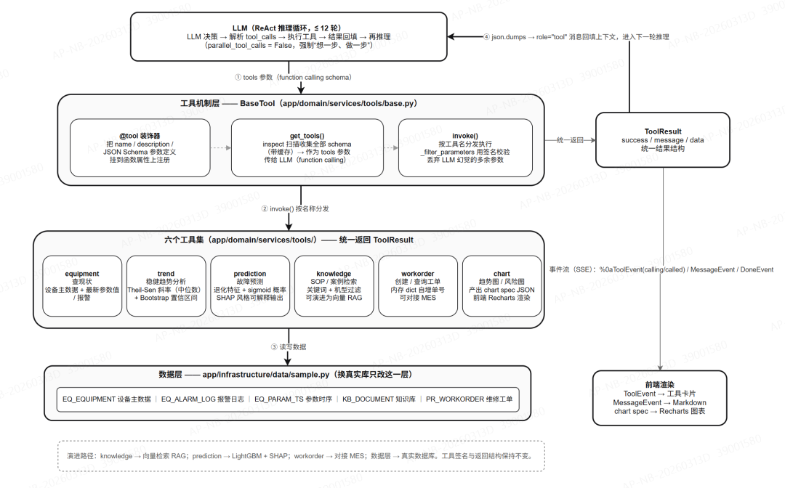
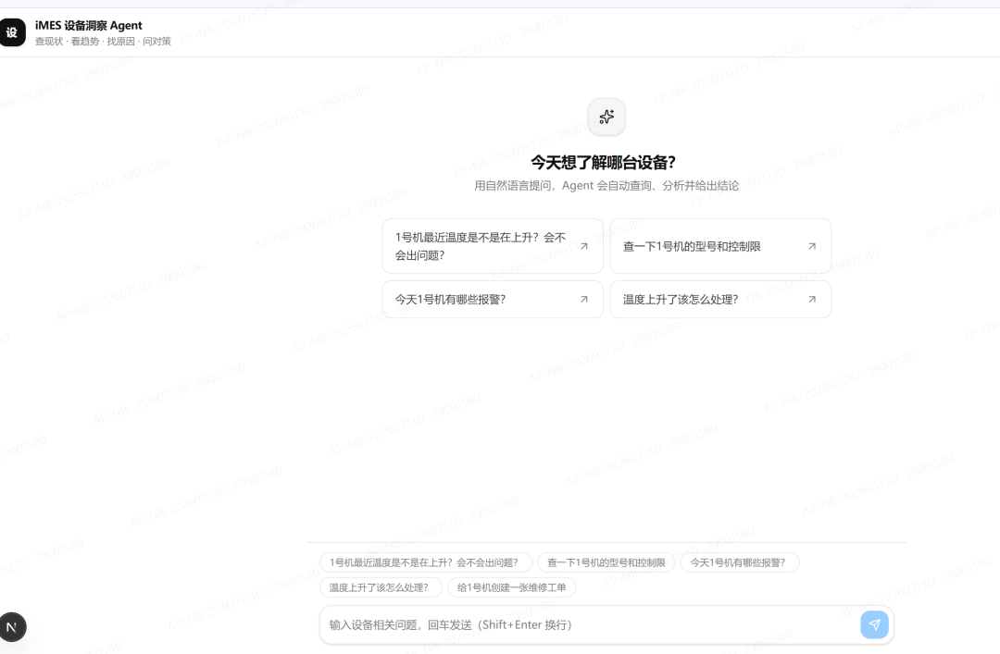
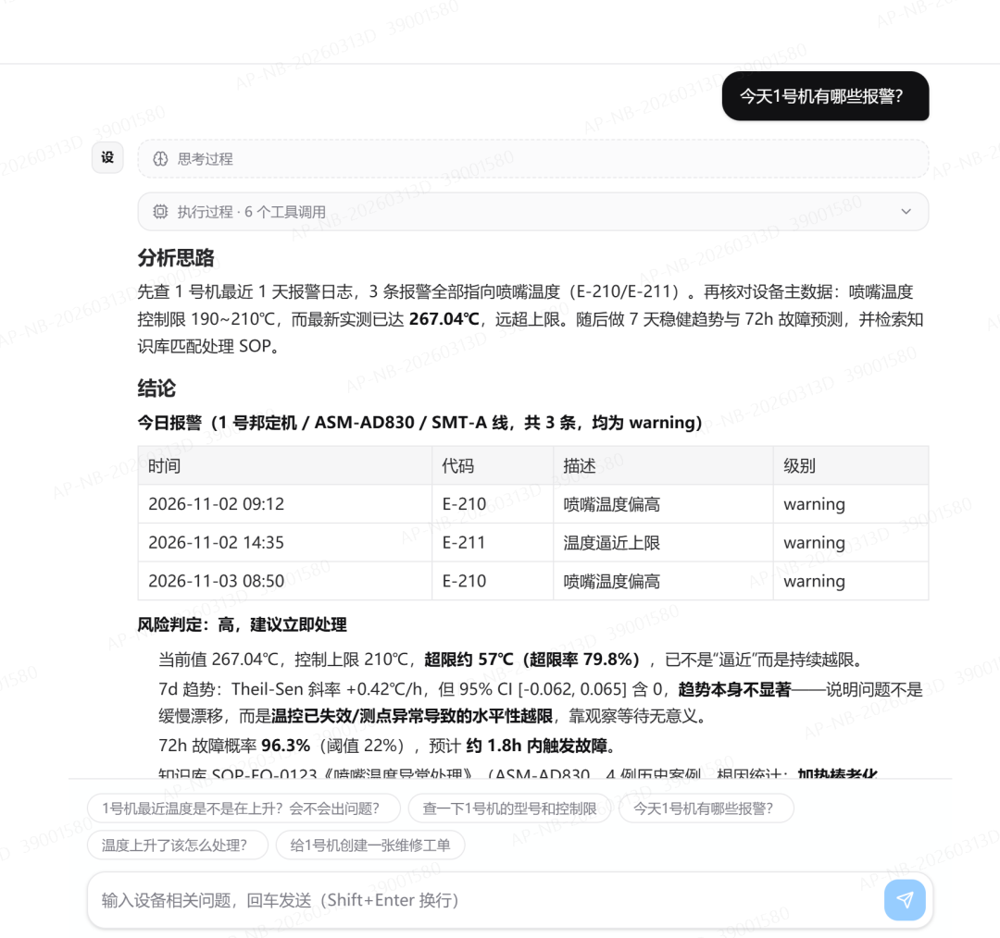
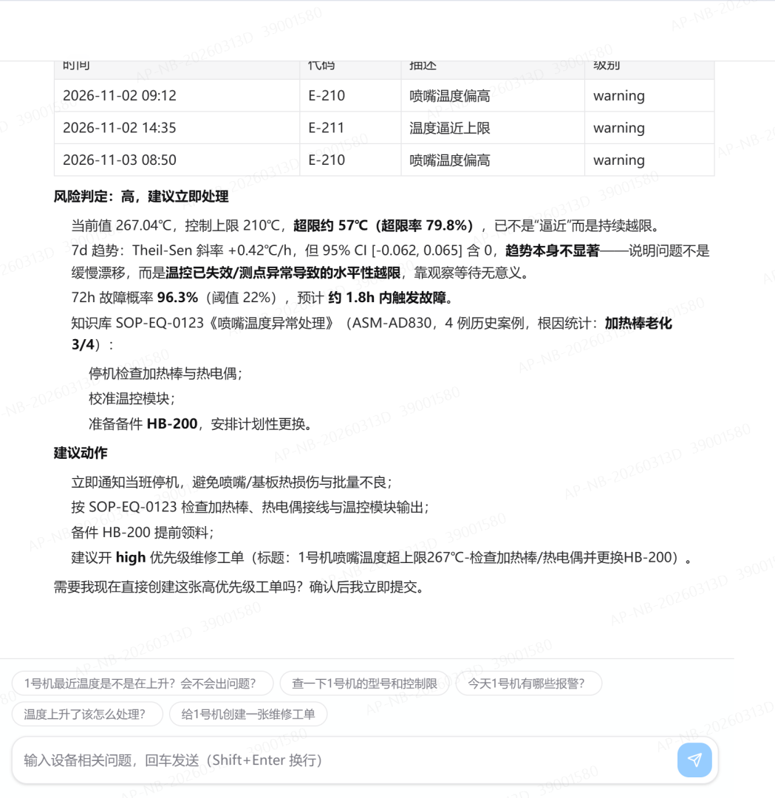
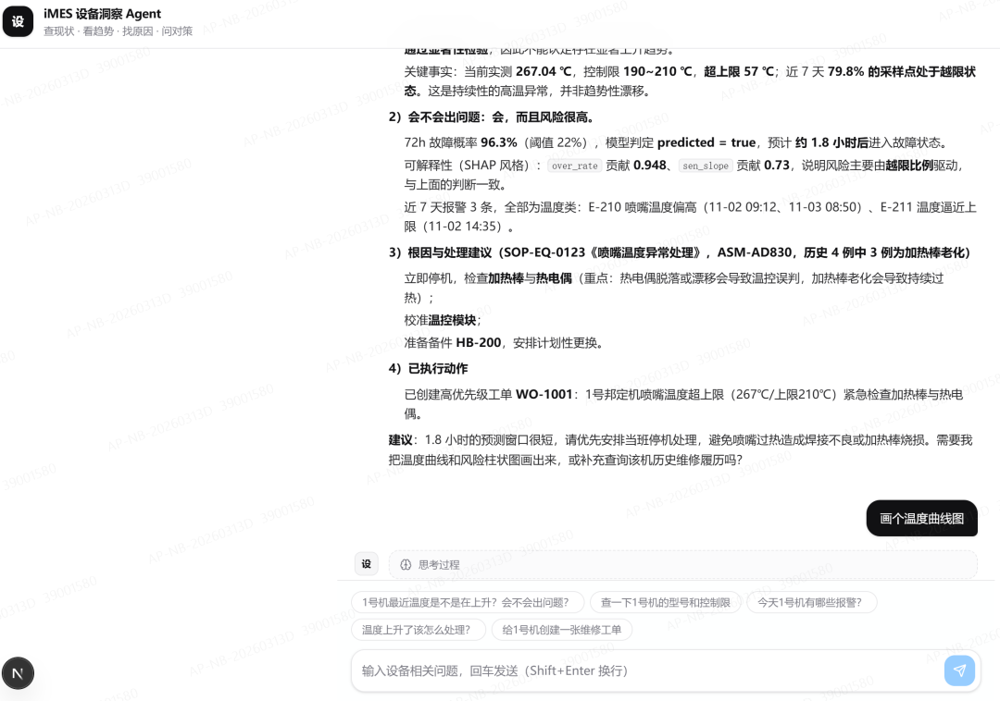

# MES 设备洞察 Agent —— 基础框架

面向**制造业设备运维**的对话式分析助手基础框架。DDD 分层多智能体系统，使用 **uv** 管理 Python 工程。

> 定位：**查现状 → 看趋势 → 找原因 → 问对策** 的闭环。班组长 / 设备工程师用自然语言即可完成设备洞察。

---

## 一、架构

| 课件章节 | 本框架实现 |
| --- | --- |
| 第 5 章 项目初始化 / 通用模块（数据源、统一响应、日志跨域） | `core/config.py` 动态配置、`interfaces/errors` 统一异常、`infrastructure/logging` 日志 |
| 第 6 章 MCP 协议 | `core/config.py` 的 `MCPConfig`（预留扩展位）、`domain/services/tools` 工具协议 |
| 第 7/8 章 LLM 模块（可动态配置 + 后台运行） | `domain/external/llm.py` 协议 + `infrastructure/external/llm`（OpenAI/DeepSeek 与 Mock 两种实现）、`application/services/agent_service.py` 后台任务运行器 |
| 第 9 章 Agent 模块 | `domain/services/agents`（BaseAgent ReAct 循环 + EquipmentInsightAgent）、事件流（ToolEvent / MessageEvent / DoneEvent） |
| 第 12 章 沙箱模块（思路预留） | 工具协议可挂载沙箱执行，基础框架先用进程内工具集 |

DDD 分层结构：

```
ims_equipment_agent/                 # 即课件中的 api/ 根
├── pyproject.toml                   # uv 工程管理
├── config.yaml                      # 业务配置（agent/llm/mcp/data_source）
├── .env.example                     # 环境变量样例
├── core/
│   └── config.py                    # Settings + AppConfig（LLMConfig/AgentConfig/MCPConfig）
└── app/
    ├── main.py                      # FastAPI 入口 + 生命周期 + CORS + 异常
    ├── domain/                      # 领域层（不依赖具体实现）
    │   ├── external/                # LLM / JSONParser 协议
    │   ├── models/                  # event / message / memory / tool_result
    │   ├── repositories/            # IMemoryRepository / IUnitOfWork
    │   └── services/
    │       ├── agents/              # BaseAgent（ReAct）+ react（设备洞察Agent）
    │       ├── tools/               # tool 装饰器 + BaseTool + 6 类工具
    │       └── analysis/            # Theil-Sen + Bootstrap 稳健趋势
    ├── infrastructure/              # 基础设施层（协议的具体实现）
    │   ├── external/llm/            # OpenAILLM(DeepSeek) + MockLLM
    │   ├── external/json_parser/    # DefaultJSONParser(json-repair)
    │   ├── logging/                 # setup_logging
    │   ├── repositories/            # InMemoryMemoryRepository
    │   └── data/                    # 内置样本数据（设备/报警/时序/知识库）
    ├── application/                 # 应用层
    │   ├── errors/                  # 统一异常
    │   └── services/agent_service.py# AgentTaskRunner（后台运行）+ AgentService（会话管理）
    └── interfaces/                  # 接口层
        ├── endpoints/               # chat(对话/SSE) + status(状态)
        ├── schemas/                 # 请求/响应模型
        ├── errors/                  # 异常处理器
        └── service_dependencies.py  # 依赖注入
```

---

## 二、内置的 6 类设备运维工具（工具设计）

| 工具集 | 工具 | 说明 |
| --- | --- | --- |
| `equipment` | `query_equipment` / `query_alarm_log` | 查设备主数据（型号/控制限）、查报警日志 |
| `trend` | `analyze_trend` | Theil-Sen 斜率 + Bootstrap 95% 置信区间（方案第5章核心算法） |
| `prediction` | `predict_failure` / `explain` | 故障概率预测 + SHAP 风格可解释性 |
| `knowledge` | `search_knowledge` | SOP / 历史案例检索（关键词 + 机型过滤） |
| `workorder` | `create_workorder` / `query_workorder` | 生成「待人工确认」的维修工单申请 / 查询已确认创建的工单（人在回路，见下） |
| `chart` | `plot_param_trend` / `plot_alarm_distribution` / `plot_failure_risk` | 产出图表规格（趋势折线图带 Theil-Sen 趋势线与控制限、报警分布柱状图、故障风险柱状图），前端用 Recharts 渲染为可交互图表 |

### 建单确认（人在回路）

写操作不允许由模型直接执行。`create_workorder` 只生成待确认申请（返回 `confirm_token` 与拟建单内容，**不创建工单**），
前端据此渲染确认卡片；用户点击「确认建单」后才由 `POST /api/workorder/confirm` 执行真正的创建。
令牌一次性、10 分钟有效，也可选择「取消」；确认入口不是 `@tool`，不出现在 LLM 的工具列表里，模型无路径绕过。
创建的工单带 `confirmed_by=user` 便于审计。

对应实现：`app/domain/services/tools/workorder.py`、`app/interfaces/endpoints/workorder_routes.py`、
`ui/src/components/tool-use/workorder-confirm-card.tsx`。

### 工具机制与实现思路

下图自顶向下展示「LLM ReAct 循环 → `BaseTool` 统一机制 → 六个工具集 → 数据层」的注册、发现、调用与结果回填过程（`ToolResult` → `role="tool"` 消息 → 下一轮推理），右侧为事件流与前端渲染。



> 可编辑源文件：[`docs/tool-architecture.drawio`](docs/tool-architecture.drawio)（draw.io / VS Code Draw.io Integration 打开）。

接入真实 LLM（DeepSeek、openAI）后，`EquipmentInsightAgent` 会按意图自主选择并串联这些工具，输出自然语言结论。

---

## 三、运行方式（uv）

```bash
# 1. 进入工程根目录（即含 pyproject.toml 的目录）
cd ims_equipment_agent

# 2. 安装依赖（uv 自动创建虚拟环境）
uv sync

# 3. 启动服务（默认 mock 模式，无需 API Key 即可演示）
uv run uvicorn app.main:app --reload --port 8000
```

> 后端 API 文档：`http://localhost:8000/docs`。

### 前端（Next.js）
前端工程位于 `ui/`（Next.js 16 + React 19 + TypeScript + Tailwind 4 + Radix/shadcn 风格组件），
通过 `POST /api/chat/stream` 的 SSE 流实时展示「工具调用过程 + 最终结论」，并支持多轮对话（复用 `session_id`）。

#### 界面预览

首页空状态与示例提问：



设备报警分析示例（含分析思路、风险判定与处理建议，长回答分两屏）：





趋势分析对话（工具调用过程 + 最终结论）：



```bash
# 另开终端，进入前端目录
cd ui
npm install        # 首次安装依赖
npm run dev        # 开发服务器，默认 http://localhost:3000
# 或生产构建： npm run build && npm run start
```

> 前端通过环境变量 `NEXT_PUBLIC_API_BASE_URL` 连接后端，默认 `http://localhost:8000/api`（见 `ui/.env.local`）；
> 生产构建可改为 `/api` 由 Nginx 反向代理。后端已开启 CORS，开发环境可直接跨端口调用。
>
> 目录结构（`ui/`）：
> ```
> ui/src/
> ├── app/                # 页面（layout.tsx 顶栏 + page.tsx 对话页）
> ├── components/
> │   ├── ui/             # shadcn 风格基础组件（button/card/input/textarea/badge/avatar/scroll-area/separator）
> │   ├── tool-use/       # 工具调用可视化卡片（calling/called 状态、入参与返回）
> │   ├── chart/          # 图表渲染（Recharts：趋势折线图 / 报警分布柱状图 / 风险柱状图）
> │   └── status-pill.tsx # 顶栏 LLM 状态指示
> ├── hooks/use-chat.ts   # 管理对话轮次与流式事件
> └── lib/api/            # 类型定义 / 配置 / SSE 客户端 / 状态接口
> ```

### 两种 LLM 模式
- **Mock 模式（默认）**：`config.yaml` 中 `llm.api_key` 留空即自动回退，用关键词意图识别驱动 ReAct 循环，便于本地演示/单测。
- **真实模式（DeepSeek）**：复制 `.env.example` 为 `.env`，填入 `LLM_API_KEY`，`llm.provider=openai`，重启即可。

---

## 四、接口示例

```bash
# 1) 状态
curl http://localhost:8000/api/status

# 2) 对话（SSE 流式，提交即输出）
curl -N -X POST http://localhost:8000/api/chat/stream \
  -H "Content-Type: application/json" \
  -d '{"message":"1号邦定机最近温度是不是在上升？会不会出问题？"}'

# 也可：先 POST /api/chat 拿到 session_id，再 GET /api/chat/stream/{session_id} 拉取
```

事件流类型：`tool`(调用中/已调用) → `message`(最终回答) → `done`。

---

## 五、如何扩展（对照方案落地）

1. **替换真实数据源**：在 `app/infrastructure/data/` 增加数据库/时序库实现，或把工具改为调用真实 MES / 数仓接口（保持返回 `ToolResult`）。
2. **接入 MCP**：新增 `app/domain/services/tools/mcp.py` 实现 `BaseTool`，在 `AgentService._tools` 注册；`MCPConfig` 已预留。
3. **持久化记忆**：把 `InMemoryMemoryRepository` 换成 Postgres/Redis 实现（`IMemoryRepository` 接口不变）。
4. **接入故障预测模型**：用 LightGBM + 真实 SHAP 替换 `prediction.py` 中的演示式评分。
5. **多 Agent 协作**：新增 `PlannerAgent`，由 `AgentService` 编排多个 `BaseAgent`。

---

## 六、技术栈

FastAPI · Uvicorn · OpenAI SDK（兼容 DeepSeek）· Pydantic / pydantic-settings · NumPy（Theil-Sen）· json-repair · uv

---

## 七、趋势分析算法说明（Theil–Sen + Bootstrap）

> **背景**：MES / BI 指标时序普遍存在传感器跳变、停机记录缺失、人工录入错误、试产批次干扰等脏数据。
> 普通最小二乘（OLS）以残差平方和最小为目标，单个极端离群点即可显著扭转回归直线方向，导致趋势判读失真。
> 本框架采用 **Theil–Sen 稳健斜率点估计 + Bootstrap 不依赖分布假设的区间估计**，替代基于 OLS 的趋势分析逻辑。
> 参考实现：[`app/domain/services/analysis/theil_sen.py`](app/domain/services/analysis/theil_sen.py)。

### 7.1 目标与适用范围

| 项目 | 说明 |
| --- | --- |
| 目标 1 | 异常值占比 ≤ 29.3% 时，斜率估计保持稳定，不被离群点带偏 |
| 目标 2 | 不假设正态分布 / 方差齐性，给出斜率的 95% 置信区间 |
| 目标 3 | 明确的显著性判读规则（置信区间是否跨越 0） |
| 目标 4 | 可工程化的性能方案，支持万级数据点的在线 / 离线计算 |
| 适用范围 | 单变量一元线性趋势：指标 y 随时间 t（或批次序号、累计产量）变化 |
| 样本量 | 建议 n ≥ 10；n 在 20 ~ 2000 区间效果最佳 |
| 前置条件 | 非平稳、含阶段性跳变的序列需先做分段处理，再分别建模 |

### 7.2 算法原理

**点估计**：对所有点对 `i < j` 且 `xᵢ ≠ xⱼ`，计算单对斜率 `s(ij) = (yⱼ − yᵢ) / (xⱼ − xᵢ)`；取全部 `s(ij)` 的中位数得 `β̂`，截距取 `α̂ = median{ yᵢ − β̂·xᵢ }`。中位数只依赖排序位置，异常值不会像 OLS 那样被平方项放大。

**稳健性来源**：崩溃点（Breakdown Point）是估计量失效前可容忍的污染数据最大比例。Theil–Sen 渐近崩溃点约 **29.3%**，OLS 为 **0%**。该稳健性主要针对 y 方向离群值；x 方向的强杠杆点仍需结合业务规则前置筛查。

**区间估计**：从 n 个样本中成对有放回抽取 n 个 `(x, y)` → 重算 `β*(b)` → 重复 B 次得到经验分布 → 取 2.5% / 97.5% 分位数得 95% CI。

> **关键约束**：必须成对重采样 `(x, y)`，不可分别独立抽取 x 与 y，否则破坏变量间依赖结构、导致区间严重失真（表现为点估计显著、CI 却跨 0）。强自相关时序应改用 **Block Bootstrap**（按连续分块整体抽取），否则区间系统性偏窄。

| 区间构造法 | 构造方式 | 特点与适用 |
| --- | --- | --- |
| 百分位法（推荐默认） | 直接取 β* 分布的 2.5% / 97.5% 分位数 | 实现最简单、最常用；样本量与 B 足够时表现良好 |
| BCa | 百分位法 + 偏差校正与加速（Jackknife 估计偏度） | 小样本、分布偏斜时更准确；实现复杂度较高 |
| 基础法 | `2β̂ − q(97.5%)` 与 `2β̂ − q(2.5%)` | 较少使用，仅在特定对称情形下等价 |

| 对比维度 | OLS 最小二乘 | Theil–Sen | Theil–Sen + Bootstrap |
| --- | --- | --- | --- |
| 崩溃点 | 0%（单点即可失效） | ≈ 29.3% | ≈ 29.3% |
| 分布假设 | 需正态、方差齐性 | 无 | 无 |
| 置信区间 | 有解析解（t 分布） | 无现成解 | Bootstrap 经验区间 |
| 计算复杂度 | O(n) | O(n²) | O(B · n²)，可采样降阶 |
| 异常值敏感度 | 极高 | 低 | 低 |
| 工程成熟度 | 极高 | 中 | 中（需自行实现） |

### 7.3 端到端流程与判读规则

| 步骤 | 环节 | 处理内容 | 输出 |
| --- | --- | --- | --- |
| S1 | 数据接入 | 按指标维度拉取时序数据 `(t, y)` | 原始序列 |
| S2 | 前置清洗 | 剔除空值、业务标注为无效的点；x 值去重统计 | 可用序列 |
| S3 | 点对斜率计算 | 计算所有 `i < j` 的 `s(ij)`，x 相同者对跳过 | 斜率集合 |
| S4 | 点估计 | 取中位数得 `β̂`，并计算截距 `α̂` | β̂、α̂ |
| S5 | Bootstrap 重采样 | 成对有放回抽样 B 次，每次重算 `β*` | 经验分布 |
| S6 | 区间构造 | 取 2.5% / 97.5% 分位数 | 95% CI |
| S7 | 趋势判读 | 判定 CI 是否跨越 0，输出结论 | 趋势结论 |

```text
if CI.下界 > 0  -> 显著上升
if CI.上界 < 0  -> 显著下降
else            -> 趋势不显著（样本不足以断定方向）
```

### 7.4 关键参数与取值建议

| 参数 | 建议取值 | 说明 | 本框架现状 |
| --- | --- | --- | --- |
| 重采样次数 B | 1000（常规）/ 5000（报告级） | B 越大区间越稳定；B=1000 时端点蒙特卡洛误差约 ±1% | `1000`（函数默认值） |
| 置信水平 | 95%（α=0.05）；探索性 90%，质量放行 99% | 分位点随置信水平变化，水平越高区间越宽 | `0.95`（函数参数可调） |
| 点对采样上限 max_pairs | 200,000；n ≤ 632 时无需采样 | n 较大时对点对随机采样近似中位数，控制耗时 | 未实现（见 7.5） |
| 最小样本量 n | ≥ 10，推荐 ≥ 20 | n < 10 时分位数极不稳定，区间不可用 | 仅 `n < 2` 保护，未设 10 的门槛 |
| x 重复处理 | 跳过 `dx = 0` 的点对 | 重复率过高需先按 x 聚合 | 已跳过，未做聚合 |
| 时间序列自相关 | Block Bootstrap，块长 ≈ n^(1/3) | 否则区间会系统性偏窄 | 未实现 |
| 随机种子 seed | 固定值 | 保证结果可复现，便于回溯与对账 | `42`（固定） |

### 7.5 本框架落地情况

| 方案要求 | 状态 | 实现位置 / 说明 |
| --- | --- | --- |
| 点对斜率中位数 `β̂` | 已实现 | `theil_sen_slope()`，向量化按行计算，跳过 `dx = 0` |
| 截距 `α̂` | 已实现 | `analyze_trend()` 返回 `intercept` |
| 成对重采样 `(x, y)` + 退化样本跳过 | 已实现 | `bootstrap_ci()`，重采样后按 x 稳定排序 |
| 百分位法 95% CI | 已实现 | `bootstrap_ci()`，`confidence` 可调 |
| 三段式显著判读 | 已实现 | 返回 `significant` / `direction` / `conclusion` |
| 前置清洗（空值 / 非有限值） | 已实现 | `analyze_trend()` 对 x、y 成对 mask，保留时间间距 |
| 固定 seed、B=1000 | 已实现 | 函数默认值，结果可复现 |
| 业务无效标记剔除、x 重复聚合、强杠杆点筛查 | 预留 | 属于数据层 / 工具层职责 |
| `max_pairs` 采样降阶、万级点在线性能 | 预留 | 当前为 `O(B · n²)`，需配置化 + 点对采样 |
| Block Bootstrap、BCa / 基础法区间 | 预留 | 强自相关时序接入真实数据源后需要 |
| 分段建模（非平稳 / 阶段跳变） | 预留 | — |
| 参数进 `config.yaml`、脏数据样本与单测 | 预留 | 当前参数写在函数签名中 |

> **调用链**：`TrendTool.analyze_trend`（按 eid / param / window 取数并切窗）→ `analyze_trend()`；`PredictionTool` 取 `sen_slope` 作退化特征，`ChartTool` 用 `theil_sen_slope()` 画稳健趋势线。三者共享同一无状态算法模块，可独立单测、可复用。

---

## 八、消息推送（P0，默认只打日志）

对外通知采用**人在回路的手动入口**：模型只能生成待确认草稿，**发不发完全由人点击决定**；
没有事件旁路、阈值规则或静默窗口，LLM 也没有任何路径直接发送。

**链路**：用户说「通知 / 推送 / 发到群 / 告诉班组」→ Agent 调用 `draft_notification` 生成草稿
（返回 `confirm_token`，**不发送**）→ 前端渲染确认卡片（标题 / 正文 / 级别 / 渠道）
→ 用户点「发送通知」→ `POST /api/notify/confirm` 校验一次性令牌后才真正投递；点「忽略」则作废。

| 项 | 说明 |
| --- | --- |
| 工具 | `draft_notification` 注册为 `@tool`，只能生成草稿；发送接口 `POST /api/notify/confirm` **不是** `@tool`，LLM 无法调用 |
| 纪律 | System 十条硬纪律第 2 条：对外通知须人工确认，模型不得声称已发送、不得代替用户确认 |
| 渠道 | `wecom`（企业微信群机器人 markdown）、`mock`（只写日志）；配置 `webhook_env` 才启用真实渠道 |
| 启用 | 复制 `.env.example` 为 `.env` 并填 `WECOM_WEBHOOK_URL`；未填时自动降级为日志模式，不会对外发送 |
| 开关 | `notify.enabled: false` 一键关闭；确认令牌一次性、10 分钟有效 |
| 可靠性 | 人工确认后同步投递并返回结果，失败重试 2 次后只记日志；webhook key 不写日志、不进异常文本 |
| 预留 | 飞书适配器、按设备 / 班组的订阅关系、交互卡片回跳发送 |

分层与 LLM 模块对称：`domain/external/notifier.py` 定义协议 → `infrastructure/external/notify/` 放渠道实现
→ `application/services/notification_service.py` 管理草稿与投递。配置见 `config.yaml` 的 `notify` 段与 `.env.example`。
